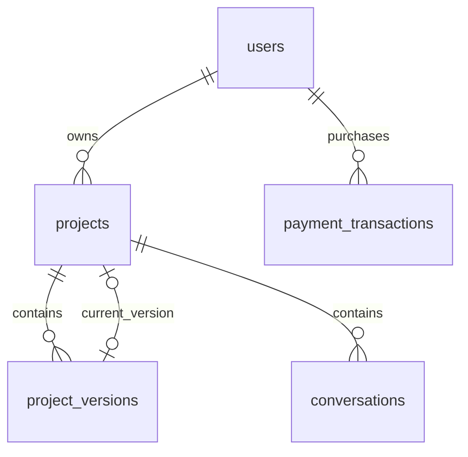

# PostgreSQL database reference

This project uses PostgreSQL 17 and the `pg` driver with explicit SQL repositories. An additional ORM is not required. Web and Android use the Express API; neither client connects directly to PostgreSQL.

## SQL files

| File                                                     | Purpose                                                                                       |
| -------------------------------------------------------- | --------------------------------------------------------------------------------------------- |
| [schema.sql](schema.sql)                                 | Complete generated DDL for a new empty database, including migration history                  |
| [migrations/001_initial.sql](migrations/001_initial.sql) | Canonical application tables, constraints, foreign keys, and indexes                          |
| [dml/examples.sql](dml/examples.sql)                     | INSERT, SELECT, UPDATE, DELETE, credit debit, and payment credit examples; ends with ROLLBACK |
| [dcl/roles.sql](dcl/roles.sql)                           | CREATE ROLE, GRANT, and REVOKE for runtime and reporting access                               |
| [migrate.js](migrate.js)                                 | Versioned, checksummed, transactional migration runner                                        |

DDL defines structure, DML reads/changes rows, and DCL assigns permissions. `BEGIN`, `COMMIT`, and `ROLLBACK` provide transaction control.

## Install and run

The chosen setup starts empty, with local `kalpriti_test` on `127.0.0.1:55432` and a separate hosted production database. These files do not import MongoDB data or seed users.

For normal application setup, run from `server`:

```sh
docker compose up -d --wait postgres
pnpm run db:migrate
```

For an SQL-only installation in a **new empty database**, use `schema.sql` instead of the initial migration command. With the PostgreSQL CLI installed, configure `PGHOST`, `PGPORT`, `PGDATABASE`, and `PGUSER`, and use a password prompt or password file:

```sh
psql -W -v ON_ERROR_STOP=1 -f db/schema.sql
```

The export records the same checksums as the migration runner, so later upgrades can use `pnpm run db:migrate`. Do not run the export against existing tables. Regenerate the export after adding migrations:

```sh
pnpm run db:export-schema
```

To try the DML examples on the local Docker database from PowerShell:

```powershell
Get-Content -Raw db/dml/examples.sql | docker compose exec -T postgres psql -U kalpriti -d kalpriti_test -v ON_ERROR_STOP=1
```

Successful execution leaves the database unchanged. Example IDs and the unusable password value are fixtures, not accounts for signing in. Production payment status must be verified with Stripe before any settlement query.

Run DCL separately as the table/database owner with permission to create roles:

```powershell
Get-Content -Raw db/dcl/roles.sql | docker compose exec -T postgres psql -U kalpriti -d kalpriti_test -v ON_ERROR_STOP=1 --single-transaction
```

Hosted environments can use the same SQL through `psql` or their SQL editor, subject to provider role-management permissions. Use separate owner credentials for migrations and runtime credentials for the API. Provision login credentials in the hosting platform and grant the appropriate group:

```sql
GRANT kalpriti_runtime TO your_application_login;
GRANT kalpriti_readonly TO your_reporting_login;
-- To remove access:
REVOKE kalpriti_readonly FROM your_reporting_login;
```

The scripts do not create login passwords or change the running API's credentials. Reapply explicit grants after introducing new tables. PostgreSQL permissions are additive: use dedicated accounts without extra role memberships or ownership privileges. See PostgreSQL's [GRANT reference](https://www.postgresql.org/docs/17/sql-grant.html).

## Relationships



`schema_migrations` is deployment metadata and has no foreign keys.

## Column dictionary

All columns are NOT NULL unless marked nullable. Application IDs are `text`; the API generates 24-character hexadecimal IDs and serializes them as `_id`. SQL deliberately has no ID generator so legacy IDs can also be preserved. All timestamps use `timestamptz`.

### users

| Column              | Type                  | Default / rule                                     |
| ------------------- | --------------------- | -------------------------------------------------- |
| id                  | text                  | Primary key                                        |
| name                | text                  | Trimmed value must be nonempty                     |
| email               | text                  | Unique; must equal lowercase trimmed value         |
| password            | text                  | bcrypt hash; never returned by the API             |
| role                | text                  | `USER`; allowed `USER`, `ADMIN`                    |
| total_creation      | integer               | `0`; nonnegative                                   |
| credits             | integer               | `20`; nonnegative                                  |
| reset_token         | text, nullable        | Hashed password-reset token                        |
| reset_token_expires | timestamptz, nullable | Password-reset expiry                              |
| otp_hash            | text, nullable        | Hashed verification OTP                            |
| otp_expires_in      | timestamptz, nullable | OTP expiry                                         |
| verified            | boolean               | `false`                                            |
| session_version     | integer               | `0`; nonnegative; invalidates older JWT sessions    |
| created_at          | timestamptz           | `now()`                                            |
| updated_at          | timestamptz           | `now()` on insert; application updates on mutation |

Migration `002_session_version.sql` adds session revocation. Password reset, password change, and logout increment this counter; tokens from earlier versions are rejected. Apply it with `pnpm run db:migrate` before deploying the updated API.

### projects

| Column             | Type           | Default / rule                                                  |
| ------------------ | -------------- | --------------------------------------------------------------- |
| id                 | text           | Primary key                                                     |
| name               | text           | Trimmed value must be nonempty                                  |
| initial_prompt     | text           | Initial generation request                                      |
| current_code       | text, nullable | Current website source                                          |
| current_version_id | text, nullable | Foreign key to project_versions; deferred until transaction end |
| user_id            | text           | Foreign key to users; ON DELETE CASCADE                         |
| is_published       | boolean        | `false`                                                         |
| created_at         | timestamptz    | `now()`                                                         |
| updated_at         | timestamptz    | `now()` on insert; application updates on mutation              |

Deleting an active version sets `current_version_id` to NULL without deleting current code. The service verifies that the active version belongs to the project; this ownership relationship is not a composite SQL constraint. The API derives `current_version_index` from ordered version IDs rather than storing a fragile array index.

### project_versions

| Column      | Type           | Default / rule                               |
| ----------- | -------------- | -------------------------------------------- |
| id          | text           | Primary key                                  |
| project_id  | text           | Foreign key to projects; ON DELETE CASCADE   |
| code        | text           | Saved source snapshot                        |
| description | text, nullable | Version label                                |
| timestamp   | timestamptz    | `now()`                                      |
| position    | integer        | Nonnegative; unique together with project_id |

### conversations

| Column     | Type        | Default / rule                               |
| ---------- | ----------- | -------------------------------------------- |
| id         | text        | Primary key                                  |
| project_id | text        | Foreign key to projects; ON DELETE CASCADE   |
| role       | text        | `user` or `assistant`                        |
| content    | text        | Message body                                 |
| timestamp  | timestamptz | `now()`                                      |
| position   | integer     | Nonnegative; unique together with project_id |

### payment_transactions

| Column            | Type           | Default / rule                                                                 |
| ----------------- | -------------- | ------------------------------------------------------------------------------ |
| id                | text           | Primary key                                                                    |
| user_id           | text           | Foreign key to users; ON DELETE RESTRICT                                       |
| plan_id           | text           | Nonblank plan identifier; plans are currently defined in application constants |
| amount            | numeric(12,2)  | Nonnegative; application currently charges INR                                 |
| credits           | integer        | Nonnegative credit quantity purchased                                          |
| is_paid           | boolean        | `false`                                                                        |
| credits_applied   | boolean        | `false`; internal once-only settlement marker                                  |
| payment_status    | text           | `Pending`; allowed `Pending`, `Paid`, `Failed`                                 |
| payment_provider  | text, nullable | `Stripe`, `Razorpay`, or `Paypal`                                              |
| payment_intent_id | text, nullable | Unique when present                                                            |
| created_at        | timestamptz    | `now()`                                                                        |
| updated_at        | timestamptz    | `now()` on insert; application updates on mutation                             |

The API verifies payment status, owner, amount, and currency with Stripe. It locks the payment row and updates the marker and user balance in one transaction. Administrative status changes do not grant credits. The database constrains each field; the service enforces transitions between payment states.

### schema_migrations

| Column     | Type        | Default / rule                       |
| ---------- | ----------- | ------------------------------------ |
| name       | text        | Primary key; migration filename      |
| checksum   | text        | SHA-256 of the exact migration bytes |
| applied_at | timestamptz | `now()`                              |

## Indexes and integrity

Primary keys and unique constraints create their supporting indexes automatically. Additional indexes are:

| Index                          | Columns / predicate                       |
| ------------------------------ | ----------------------------------------- |
| users_reset_token_idx          | reset_token WHERE reset_token IS NOT NULL |
| projects_user_created_idx      | user_id, created_at DESC                  |
| projects_published_updated_idx | updated_at DESC WHERE is_published        |
| transactions_user_created_idx  | user_id, created_at DESC                  |

Version/message uniqueness on `(project_id, position)` also supports ordered history queries. The version pointer uses a deferred foreign key to support creation and deletion in a single transaction. Credit changes use conditional updates and transactions. `updated_at` has no trigger: direct SQL writers must update it explicitly.

## Database roles

| Group                                    | Permissions                                                                                                      |
| ---------------------------------------- | ---------------------------------------------------------------------------------------------------------------- |
| Migration owner (provided by deployment) | Owns schema/tables; applies migrations and manages grants                                                        |
| kalpriti_runtime                         | Application SELECT/INSERT/UPDATE/DELETE; no migration-table access or permanent schema CREATE                    |
| kalpriti_readonly                        | SELECT on projects, versions, conversations, payments, migration history, and explicit nonsensitive user columns |

The reporting group can read application content and financial history; grant it only to authorized reporting accounts. It cannot select password/reset/OTP columns or perform writes. Neither group has LOGIN. The application's `USER`/`ADMIN` values are application authorization roles and are separate from PostgreSQL roles. API ownership checks enforce per-user access; these scripts do not install row-level security policies.
